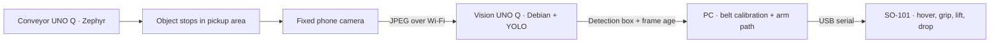

# Camera-guided pickup



This is a supervised one-object cycle. The conveyor firmware has its own
ultrasonic stop and speed controller. Switch off conveyor motor power before
working in the pickup area or enabling arm moves. Once the arm is clear and the
part is in the bin, restart the belt at the station.

## Qbot and phone

Copy `tools/vision_server.py`, `tools/detect_snapshot.py`, and
`tools/phone_capture.html` to the same directory on Qbot. Connect Qbot and the
phone to the same LAN.

On Qbot, create the environment from that directory:

```sh
sudo apt install python3-venv libjpeg-turbo-progs
python3 -m venv .venv
.venv/bin/python -m pip install torch==2.8.0 torchvision==0.23.0 --index-url https://download.pytorch.org/whl/cpu
.venv/bin/python -m pip install ultralytics-opencv-headless==8.4.218
```

Put your checkpoint in `models/tape-box-yolov8n.pt`. Start the server:

```sh
.venv/bin/python -u vision_server.py --jpeg-checker djpeg \
    --yolo-weights models/tape-box-yolov8n.pt --yolo-confidence 0.25
```

Open `http://<qbot-ip>:8000/phone` on the phone. For live capture, the browser
needs a secure context. On a private bench network, Chrome's
`chrome://flags/#unsafely-treat-insecure-origin-as-secure` can enable camera
access for the exact Qbot origin, including `:8000`. Relaunch Chrome, open the
page, tap **Start live camera**, and allow the camera. For manual capture, tap
**Take photo**. Check lens selection in the live preview and keep the phone,
lens, and zoom fixed for calibration and pickups.
[Chromium camera setup](https://chromium.googlesource.com/playground/chromium-org-site/%2B/refs/heads/main/Home/chromium-security/deprecating-powerful-features-on-insecure-origins.md)

The server exposes the most recent annotated JPEG at `/latest.jpg` and the
bounding boxes, labels, frame dimensions, and age at `/latest.json`. If the part
is small in the full frame, restart with `--yolo-crop LEFT TOP RIGHT BOTTOM`
around the pickup area. The returned coordinates still refer to the full frame.
Choose the crop from your mounted camera's image and leave room for the complete
object at each expected pickup position.

## Train the tape and box model

Start from the Open Images YOLOv8n checkpoint and fine-tune it on photos taken
from the mounted phone. Draw one box per tape roll or small box, and include
object-free photos of the belt. Put different photo bursts in training and
validation so adjacent shots don't inflate the score. Add an independent test
set with parts in different positions and an empty belt.

Use the Ultralytics detection dataset layout with class names `Tape roll` and
`Small box` in the dataset YAML. The two training passes used on this station
were:

```sh
yolo detect train model=yolov8n-oiv7.pt data=dataset.yaml imgsz=512 epochs=80 patience=18 batch=8 freeze=10 optimizer=AdamW lr0=0.001 mosaic=0.25 close_mosaic=10 degrees=12 translate=0.15 scale=0.35 seed=42 project=runs name=tape-box-v1
yolo detect train model=runs/tape-box-v1/weights/last.pt data=dataset-with-backgrounds.yaml imgsz=640 epochs=50 patience=18 batch=8 freeze=10 optimizer=AdamW lr0=0.0006 mosaic=0 degrees=10 translate=0.12 scale=0.30 seed=42 project=runs name=tape-box-v2
```

The second pass adds object-free crops from the training split. Choose a
checkpoint and confidence threshold using your held-out pictures. The station
uses the second pass's `last.pt` at a 0.25 threshold and a crop around the
pickup area. The original training photos and weights are local artifacts.
[Open Images weights](https://docs.ultralytics.com/datasets/detect/open-images-v7#open-images-v7-pretrained-models) ·
[YOLO label format](https://docs.ultralytics.com/datasets/detect/)

## PC and arm

From the repository directory on Windows:

```powershell
py -3.12 -m venv .arm-venv
$python = ".\.arm-venv\Scripts\python.exe"
& $python -m pip install 'lerobot[core-scripts,feetech]==0.7.0' numpy
& .\.arm-venv\Scripts\lerobot-calibrate.exe --robot.type=so101_follower --robot.port=COM7 --robot.id=sorting_arm
```

Replace `COM7` and the robot ID if needed. Keep the same ID when recording
poses and running the station. Support the arm when positioning it with torque
off. Use the calibration and teaching procedure for your arm before attempting
powered motion. [LeRobot SO-101 setup](https://huggingface.co/docs/lerobot/so101)

### Record the camera and arm references

1. Lay a measured square flat at the pickup spot and capture it in the same
   camera mode used for sorting. In the full-resolution JPEG, note the pixel
   coordinates `u v` of the four corners, clockwise from your chosen point 1.
2. Run the camera calibration command with the actual image dimensions and
   pixel coordinates. The values below are an example for a 30 mm square.
3. Hold the open fingers above each corner at the same height and with the same
   wrist angle. A pointer secured to the gripper makes the alignment easier to
   see. Record points 1–4 in the same order. The fourth point checks the fit of
   the first three, and the tool reports how much the recorded heights differed.
4. Teach `above_pickup` with open fingers above the center of the square.
   Teach the object-specific `grasp` pose at the desired grip height with the
   fingers open on either side. Teach `above_bin` at the release point with
   clearance over the bin rim. Use a separate waypoint file for each part or
   bin if its grasp or drop pose differs.

```powershell
& $python tools/calibrate_pickup.py camera local/camera.json --image-size 960 1280 --corners 623 397 658 420 633 451 597 428

& $python tools/calibrate_pickup.py point local/camera.json local/registration.json 1 --port COM7
# Repeat at points 2, 3, and 4 with the corresponding number.

& $python tools/calibrate_pickup.py teach local/tape-waypoints.json above_pickup --port COM7
& $python tools/calibrate_pickup.py teach local/tape-waypoints.json grasp --label 'Tape roll' --port COM7
& $python tools/calibrate_pickup.py teach local/tape-waypoints.json above_bin --port COM7
```

The calibration maps pixels on the belt plane. An oblique camera can shift the
apparent center of a raised object. Check the physical alignment at hover
before descending.

### Run a trial

Replace the paper with a tape roll, keep the phone feed open, and use the PC
terminal. Set `$qbot` to the board's IP address.

If torque is off, support the arm at the taught hover pose and keep hands
clear. This command sets the servo targets to the current encoder positions
before engaging torque. Check that the arm holds before removing the support.

```powershell
& $python tools/calibrate_pickup.py hold --port COM7
```

```powershell
$qbot = 'http://192.168.0.121:8000'
$inputs = @('local/camera.json', 'local/registration.json', 'local/tape-waypoints.json')

& $python tools/vision_pick.py @inputs --port COM7 --check-start
& $python tools/vision_pick.py @inputs --qbot $qbot
& $python tools/vision_pick.py @inputs --qbot $qbot --port COM7 --hover
# After a successful hover trial, return to the taught start pose before a pick trial.
& $python tools/vision_pick.py @inputs --qbot $qbot --port COM7 --pick --grasp-offset-mm 0
```

- **Preview** prints the planned target and does not open the serial port.
- **Check start** reads the arm and reports its distance from the taught hover
  pose. It works with the phone feed off and sends no motion commands.
- **Hover** starts only with the gripper open and the arm already holding near
  the taught hover pose. Power off the belt, clear the path, and type `MOVE`
  when prompted. The planner starts from the measured joint angles, preserves
  the gripper's approach direction, and stops above the object.
- **Pick** requires a registration fit and independent check within 5 mm,
  a consistent recording height, and a grasp taught for the requested class.
  The arm pauses above the object. Type `PICK` only once both fingers visibly
  straddle the part. The script recalculates a vertical descent from that
  measured hover pose. It checks the height and sideways drift on each step,
  then checks gripper load, lifts before swinging, and releases above the
  taught bin. It checks fresh frames from Qbot afterward. Visually check the
  bin and pickup area before restarting the belt. A missing detection can
  also be a model miss.

The PC solves inverse kinematics to turn each requested tool position into
joint angles. During motion it estimates the tool position again from the
returned joint angles. A small settling error can be corrected within the
path limits. If the tool leaves those limits, the script holds its position.
The encoders measure the joints. Use the side view to check finger clearance
and alignment at the pause before grasping.

The initial bench registration had a 7.0 mm independent check error and a
7.8 mm maximum fit error. It supports a hover trial. Repeat the registration
at a consistent height before trying the full camera-guided pick.

## Automatic pickup with retries

Use the supervised trial to verify each object's grasp height, jaw opening,
and bin route first. Keep the conveyor motor power off for the automatic
bench cycle. The automatic script takes one object at a time.
Automatic pickup accepts up to 10 mm of XY registration fit error and
independent check error. The recorded reference heights must be within 5 mm
of each other.

Teach an **observation** pose with the arm out of the pickup camera view and
above the belt. Check the open-gripper route from observation to each object's
taught hover, then from each bin back to observation. Record the pose:

```powershell
& $python tools/calibrate_pickup.py teach local/station.json observation --port COM7
```

Add an `objects` key to the generated `local/station.json`. Keep the existing
`robot_id` and `waypoints` keys. Each filename is relative to the station file.
Teach a separate `above_pickup`, labeled `grasp`, and `above_bin` in each
object file:

```json
{
  "Tape roll": "tape-waypoints.json",
  "Small box": "box-waypoints.json"
}
```

Use these commands from the repository root. The first reads the phone
feed and reports the selected object and bin without connecting to the arm.
For the second, start live capture, place the arm at the taught observation
pose with the servos holding, and clear the path:

```powershell
& $python tools/auto_sort.py local/camera.json local/registration.json local/station.json --qbot $qbot
& $python tools/auto_sort.py local/camera.json local/registration.json local/station.json --qbot $qbot --port COM7 --execute --attempts 3
```

The script waits for one fresh frame containing a configured object within the
calibrated square or up to 10 mm beyond an edge. Set `--pickup-margin-mm 0` to
use only the square. Use `--confirm-detection` to require two frames that agree.
It converts the center to arm XY, moves above it, descends
to the taught height, and closes the gripper. If the jaws reach the closing
limit without contact, the arm reopens them, lifts clear, and moves back to
observation. It then uses a new detection, reports how far the object shifted,
and computes a new target for the same class. Keep the phone tab in the
foreground so it continues uploading.

After a verified grip, the arm lifts, moves to the selected object's bin,
releases it, and returns to observation. The retry count is configurable
from 1 to 5. If the part is pushed beyond the square, the camera times out,
or the scene stays ambiguous, the arm waits at observation and the cycle
ends. An unstable grip stops the cycle in place. Inspect the belt and bin
before restarting the conveyor.

## GitHub

Track the application code, documentation, and Zephyr sources. Keep your
captures, dataset, weights, and your machine's calibration and waypoints in
the ignored `local/`, `datasets/`, `models/`, or `runs/` directories.
From the repository root, stage this workflow separately from any bench edits:

```powershell
git add -- .gitignore README.md docs/camera-guided-pickup.md
git add -- tools/auto_sort.py tools/calibrate_pickup.py tools/detect_snapshot.py tools/phone_capture.html tools/preview_pickup.py tools/so101_pick.py tools/vision_pick.py tools/vision_server.py
git diff --cached --check
git diff --cached --stat
git commit -m "Add supervised camera-guided sorting workflow"
git push -u origin HEAD
```

The existing
[motor PI notes](motor-pi-tuning.md) explain the conveyor controller.
