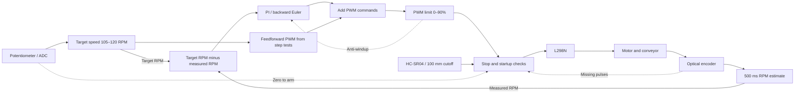

# Conveyor motor PI tuning

I ran four open-loop tests on the conveyor UNO Q with a 6 V motor supply.
Each test held the starting duty for 10 s, stepped to 90% PWM, and ran for
another 10 s. The STM32 recorded the cumulative encoder count every 100 ms.

## Motor gain

I fit a straight line to the encoder counts during the last 2.5 s of each
hold, using the actual sample timestamps. The slope is in pulses per second.
I assumed 20 slots on the disk and one counted edge per slot, so I
multiplied the slope by `60 / 20` to get the gearbox speed in RPM.

The four fits gave these speeds and gains.

- 60% to 90% PWM, 103.38 to 123.88 RPM, $K = 0.683$
- 65% to 90% PWM, 107.70 to 130.56 RPM, $K = 0.915$
- 70% to 90% PWM, 109.55 to 125.78 RPM, $K = 0.812$
- 80% to 90% PWM, 122.03 to 131.02 RPM, $K = 0.898$

For the 60% to 90% test, the calculation is

$$
K = \frac{123.88 - 103.38}{90 - 60}
  \approx 0.683\ \frac{\mathrm{RPM}}{\text{PWM percentage point}}.
$$

I used the median of the four gains, $K = 0.8552$. This is a local gain for
the speed range and belt load used in the tests.

## Discrete-time PI calculation

At 100 ms per sample, one encoder pulse changes a single speed estimate by
30 RPM. The transients in these runs were too short to estimate a motor time
constant from that data. I used the static gain above and included the speed
averaging in the model.

The controller updates about every $T_s = 0.1$ s and measures speed over the
previous five intervals. Approximating each interval's speed by the duty
applied at its start gives

$$
G(z) = \frac{K}{5}\left(z^{-1}+z^{-2}+z^{-3}+z^{-4}+z^{-5}\right).
$$

The PI uses the current error $e[k]$ to update the integral before computing
the new duty. The feedforward duty is fixed for a given setpoint, so the
feedback part of the calculation is

$$
I[k] = I[k-1] + K_i T_s e[k], \qquad
C(z) = K_p + \frac{K_i T_s}{1-z^{-1}}.
$$

I picked a 2 s closed-loop time constant for the first test, which puts the
desired pole at $z_d = \exp(-T_s/2) = 0.951229$. I also chose $K K_p = 0.20$
to keep the proportional correction small when the encoder count changes
by one pulse.

$$
K_p = \frac{0.20}{0.8552} = 0.2339.
$$

Setting $1 + C(z_d) G(z_d) = 0$ and using $G(z_d) = 0.9961$ gives

$$
K_i =
-\frac{\left(1+K_pG(z_d)\right)\left(1-z_d^{-1}\right)}
      {T_sG(z_d)}
= 0.6346.
$$

The rounded gains are $K_p = 0.234$ in PWM percentage points per RPM and
$K_i = 0.635$ in PWM percentage points per RPM-second. I checked the
closed-loop poles for gains from 0.68 to 0.92 RPM per PWM percentage point
using the sampled model. The largest pole magnitude was 0.9603.
[Background on digital motor speed control](https://ctms.engin.umich.edu/CTMS/?example=MotorSpeed&section=ControlDigital)

## Backward-Euler update

The [STM32 firmware](../firmware/motor-test/src/main.c) uses the current
sample's error in the integral update. This is backward Euler. The code uses
the measured time between updates in seconds in place of the nominal
100 ms period used in the model.

```c
integral += Ki * error * dt_s;
duty = feedforward + Kp * error + integral;
```

I kept backward Euler because it matches the controller used for the pole
calculation. The update period is short compared with the 2 s design time
constant, and the encoder estimate already uses a 500 ms window.

The duty stays between 0% and 90%. The controller pauses integration if the
output is already at a limit and the error would push it farther. An
ultrasonic stop or encoder fault sets duty to zero and clears the integral.

## Control loop



The knob sets the gearbox output speed. If the encoder and drive roller share
a shaft, multiply the measured RPM by the roller circumference and divide by
60 to get the belt speed in meters per second. Use the roller diameter in
meters and assume the belt does not slip.
