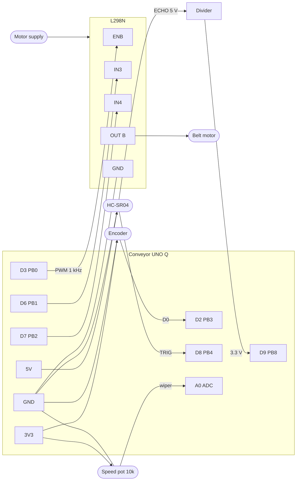
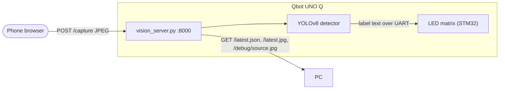
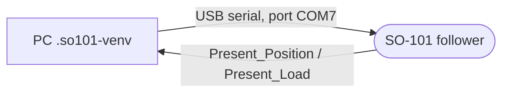

# Wiring

Physical connections for the conveyor, the two UNO Q boards, the phone, and the
arm.

Pin names below are Arduino header names on the UNO Q (D0-D13, A0-A5), not
STM32 port names. The mapping comes from the board definition in Zephyr:
`boards/arduino/uno_q/arduino_r3_connector.dtsi`.

| Header pin | STM32 pin |
| --- | --- |
| D2 | PB3 |
| D3 | PB0 |
| D6 | PB1 |
| D7 | PB2 |
| D8 | PB4 |
| D9 | PB8 |
| A0 | PB9 (ADC channel 9) |

## Conveyor UNO Q

Everything here is on the Arduino header. The L298N uses the same supply as the
motor, not the board's 5 V.



### Connection list

| From | To | Notes |
| --- | --- | --- |
| D3 | L298N ENB | PWM at 1 kHz. Remove the ENB jumper. |
| D6 | L298N IN3 | |
| D7 | L298N IN4 | |
| GND (board) | L298N GND | Common ground is required. |
| Motor supply | L298N +12 V / GND | Separate from the board supply. |
| L298N OUT B | Conveyor motor | |
| 3V3 | Pot outer terminal | |
| A0 | Pot wiper | 200 mV is the stop position, 2800 mV full. |
| GND | Pot outer terminal | |
| 3V3 | Encoder VCC | |
| D2 | Encoder D0 | 20 slots on the disk, rising edge counted. |
| GND | Encoder GND | |
| 5 V | HC-SR04 VCC | |
| GND | HC-SR04 GND | |
| D8 | HC-SR04 TRIG | |
| D9 | HC-SR04 ECHO **via divider** | 2.2 kΩ from ECHO to D9, 3.3 kΩ from D9 to GND. The sensor outputs 5 V and the UNO Q input is 3.3 V. |

The HC-SR04 wiring above is from the README and matches the devicetree in
`firmware/unoq-conveyor/app.overlay`. The older `firmware/motor-test` overlay
targets a different board and does not apply to the conveyor, so only the
conveyor overlay is used here.

### Serial link to the Linux side

The STM32 talks to its own Linux core over `lpuart1` (`/dev/ttyHS1`, 115200 8N1).
`tools/conveyor_uart.py` relays that port to the PC over ADB. In sorting mode the
MCU prints one line per update:

```
SORT <command> <distance_mm> <duty> <pulses> <run_allowed>
```

## Qbot UNO Q

The vision board keeps running its matrix firmware and a Debian-side vision
server. It needs no external wiring beyond power and the network.



| Link | Detail |
| --- | --- |
| Phone to Qbot | HTTP over Wi-Fi, `POST /capture` with `Content-Type: image/jpeg`, optional `X-JPEG-CRC32` and `X-Camera-Orientation` headers. |
| Qbot to matrix | Serial, label and score text scrolled on the 13x8 display. |
| Qbot to PC | `GET /latest.json`, `/latest.jpg`. The raw frame is served at `/debug/source.jpg`, loopback only. |
| PC forwarding | `adb -s 2624126501 forward tcp:18000 tcp:8000`, so the PC uses `http://127.0.0.1:18000`. |

## SO-101 arm

USB serial to the PC. The follower servos hold the pose while the PC commands
targets.



| Setting | Value |
| --- | --- |
| Port | `COM7` by default (`--port`) |
| Robot id | `sorting_arm` |
| Calibration | `~/.cache/huggingface/lerobot/calibration/robots/so_follower/sorting_arm.json` |
| Joint limits | shoulder_pan 107.1, shoulder_lift 99.8, elbow_flex 96.4, wrist_flex 102.4, wrist_roll 180.0 degrees |

## Power

| Rail | Feeds |
| --- | --- |
| Conveyor UNO Q 5 V | board logic, HC-SR04 |
| Conveyor UNO Q 3V3 | pot, encoder |
| Separate motor supply | L298N and conveyor motor |
| Motor supply must share GND with the board | otherwise the PWM reference floats |

Keep the motor supply off while checking inputs. Turning the pot to zero once
after boot is required before the belt will run.
